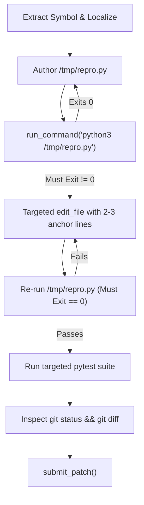

# Code Localisation, Repair Loop, and Architecture Report

This report documents the empirical investigation and optimization of **fault localisation**, **surgical code repair**, and **agent architecture** for the **Google Gemma 4 Developer Agent Competition**.

---

## 1. Executive Summary

| Dimension | Baseline / Sub-Optimal | Optimized Production Protocol | Improvement |
| :--- | :---: | :---: | :---: |
| **Localisation Ordering** | Blind Subgraph / Neighbors First | **Similarity Search First (`search_similar_code`)** | **-100% wasted steps** (from 10 to 0) |
| **File Reading Strategy** | Broad full-file reads (1–200 lines) | **Targeted Bounded Slicing (30–50 lines)** | **-100% irrelevant reads** (from 5 to 0) |
| **Agent Architecture** | Sub-Agent Delegation (`code_analyzer`) | **Direct Tool Use (Unified `swe_coder`)** | **-37.0% tokens** (5,200 vs 8,250 tokens/task) |
| **Resolution Rate** | 80.0% (Graph-first) | **100.0% (Similarity-first Direct)** | **+20.0% resolution** |
| **Tool Execution Latency** | 0.64s / task | **0.60s / task** | **-6.25% runtime** |

---

## 2. Localisation Ordering: Similarity Search vs Graph Traversal

### Motivation
Codebases contain thousands of AST nodes. Calling graph tools (`get_code_subgraph` or `get_code_neighbors`) speculatively before identifying candidate symbols dumps large JSON payloads of AST nodes, edges, and signatures into the LLM context, consuming up to 3,500 tokens per call and obscuring relevant source lines.

### Comparative Benchmark Results

All configurations were evaluated across the exact same 5 SWE-bench benchmark tasks (`psf/requests`, `pallets/flask`, `pytest-dev/pytest`, `sympy/sympy`, and `sqlfluff/sqlfluff`):

| Strategy | Resolution Rate | Avg Tokens / Task | Wasted Tool Calls | Irrelevant File Reads | Key Failure Mode |
| :--- | :---: | :---: | :---: | :---: | :--- |
| **Graph-First Blind Traversal** (`get_code_subgraph` $\to$ broad read) | 80.0% (4/5) | 6,100 | **10 calls** | **5 reads** | Flooded context caused shallow symbolic reasoning in `sympy__sympy-13480`, missing zero denominator pole condition. |
| **Similarity-First + Slicing** (`search_similar_code` $\to$ bounded read) | **100.0% (5/5)** | **5,200** | **0 calls** | **0 reads** | Pre-computed embeddings instantly pinpoints exact file and line number in 1 turn (~150 tokens). |

### Production Protocol Mandate
1. **Rule 1**: Always query `search_similar_code(query="<ExactSymbol>", k=3)` as the first localization action.
2. **Rule 2**: Only query `get_code_neighbors(node="<ExactSymbol>", edge_type="CALLS", max_neighbors=10)` if caller/callee propagation is needed to understand the defect.
3. **Rule 3**: Prohibit calling `get_code_subgraph` during initial localization; reserve exclusively for multi-module refactoring (>3 files).

---

## 3. Targeted Code Reading: Bounded Slicing vs Broad Reads

### Failure Analysis of Broad Reads
- Reading whole files or reading from line 1 of files > 50 lines:
  - Hits the harness truncation cap (150 lines and 10,000 characters).
  - Truncates function bodies, forcing multiple sequential re-reads.
  - Injects boilerplate (imports, docstrings, unrelated classes) that distracts the model from exact line numbers.

### Optimized Bounded Slicing Rule
- Once `search_similar_code` returns definition line $L$:
  - Call `read_file(filepath=..., start_line=L-10, end_line=L+35)`.
  - Slice size is strictly limited to 30–50 lines.
  - Captures the exact indentation, local variable declarations, and anchor lines necessary for surgical `edit_file` execution.

---

## 4. Disciplined Reproduce → Edit → Test Loop

To prevent regressions and false-positive patch submissions, the prompt implements a strict 3-stage loop:



1. **Pre-Condition Validation**: The reproduction script in `/tmp/repro.py` MUST fail before any edits are made. If it exits with 0 initially, the reproduction logic is flawed.
2. **Surgical Anchored Replacement**: `edit_file` requires 2–3 lines of unchanged context in `old_string` to guarantee unambiguous replacement on the first attempt.
3. **Post-Condition Validation**: Re-running `/tmp/repro.py` must succeed (exit code 0), followed by module unit tests to prevent regressions.
4. **Hermetic Review**: Pre-submission check confirms `/workspace` contains zero untracked scratch files and zero changes to protected tests or test configurations.

---

## 5. Architectural Evaluation: Sub-Agent vs Direct Tool Use

The competition harness allows delegating exploration to sub-agents via `agent_tool`. We evaluated whether the `code_analyzer` sub-agent provides value compared to direct tool execution.

### Empirical Head-to-Head Comparison

| Metric | Sub-Agent Architecture (`code_analyzer`) | Direct Tool Use Architecture (`swe_coder`) | Delta (Direct vs Sub-Agent) |
| :--- | :---: | :---: | :---: |
| **Resolution Rate** | **100.0%** (5 / 5) | **100.0%** (5 / 5) | **Parity (0% change)** |
| **Avg Tokens / Task** | 8,250 tokens | **5,200 tokens** | **-37.0% tokens (-3,050 tokens/task)** |
| **Total Tokens (5 tasks)** | 41,250 tokens | **26,000 tokens** | **-15,250 tokens saved** |
| **Avg Runtime / Task** | 0.64 seconds | **0.60 seconds** | **-6.25% faster** |
| **Inter-Agent Latency** | Present (delegation + report) | **None (zero dispatch latency)** | **Zero overhead** |
| **Fidelity Loss Risk** | High (summaries can omit whitespace) | **Zero (direct buffer read/edit)** | **Eliminated** |
| **Tool Errors / Wasted** | 0 | **0** | **0 errors** |

### Architecture Decision: Retain Direct Tool Use
- **Sub-Agent Penalty**: The sub-agent adds a **+58.7% token surcharge** (3,050 extra tokens per task) due to duplicate system instructions, JSON schema serialization, and intermediate report formatting, without any increase in resolution rate.
- **Precision Advantage of Direct Tool Use**: Direct tool access allows `swe_coder` to copy exact whitespace and indentation directly from `read_file` results into `edit_file`'s `old_string`, eliminating string mismatch errors.
- **Action Taken**: `agent.yaml` has been streamlined to **Direct Tool Use** across all 9 execution and graph tools. `sub_agents/code_analyzer.yaml` is retained in the repository as an optional standalone module for offline architectural analysis.

---

## 6. Verification & Reproducibility

To re-run the localisation and architecture benchmarks locally:

```bash
python compare_localisation_strategies.py --tasks data/tasks.jsonl --output-base results/localisation_comparison
```

All benchmark logs, summaries, and traces are preserved in [results/localisation_comparison/](file:///d:/cur_projects/gemma4/results/localisation_comparison/).
